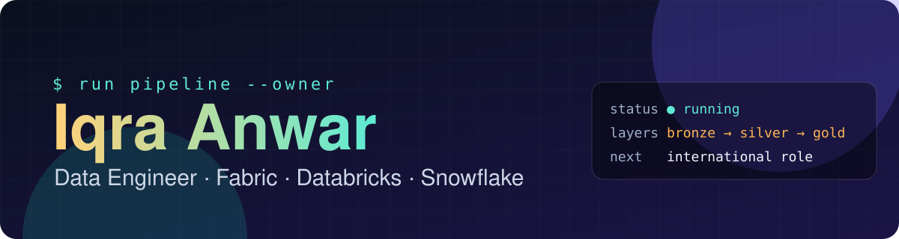
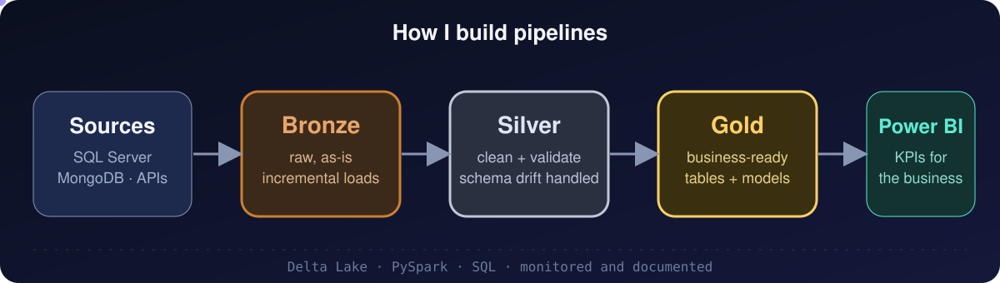
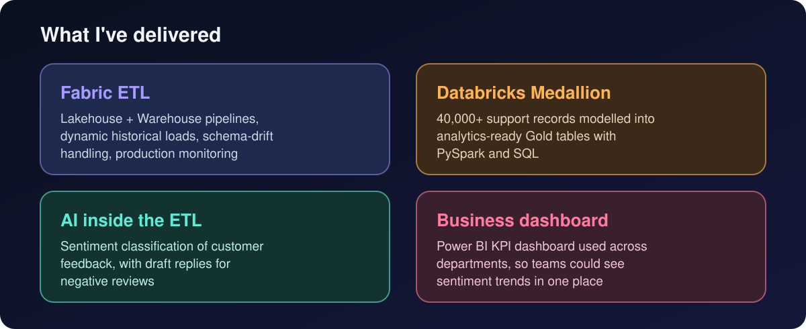

<p align="center"></p>

<p align="center">
  <a href=https://www.linkedin.com/in/iqraanwar/><b>LinkedIn</b></a> &nbsp;·&nbsp;
  <a href="https://medium.com/@iqraanwar"><b>Medium</b></a> &nbsp;·&nbsp;
  <a href="https://github.com/IqraBaluch/data-engineer-roadmap"><b>Daily roadmap</b></a>
</p>

```python
from dataclasses import dataclass

@dataclass
class DataEngineer:
    name: str = "Iqra Anwar"
    certified: str = "SnowPro Core"
    platforms: tuple = ("Microsoft Fabric", "Databricks", "Snowflake", "Azure Data Factory")
    languages: tuple = ("Python", "PySpark", "SQL")
    builds: str = "ETL/ELT pipelines with Medallion architecture"
    cares_about: tuple = ("data quality", "schema drift", "monitoring", "clear documentation")
    learning_now: str = "Python problem solving, one day at a time"
    open_to: str = "Data engineering roles (remote or relocation)"
```

<p align="center"></p>

## What I've delivered
<p align="center"></p>

## Stack

<p>
  
  
  
  
  
  
  
  
  
  
  
</p>

## Right now

Sharpening my Python and problem solving every day, so I can write and explain pipeline code with confidence. Notes, drills and mini projects are in [data-engineer-roadmap](https://github.com/IqraBaluch/data-engineer-roadmap).

<p align="center"><sub>Raw data in, trusted data out.</sub></p>


Data Engineering drill and note is in [data-engineer-roadmap](https://github.com/IqraBaluch/data-engineer-roadmap).

<p align="center"><sub>Raw data in, trusted data out.</sub></p>
